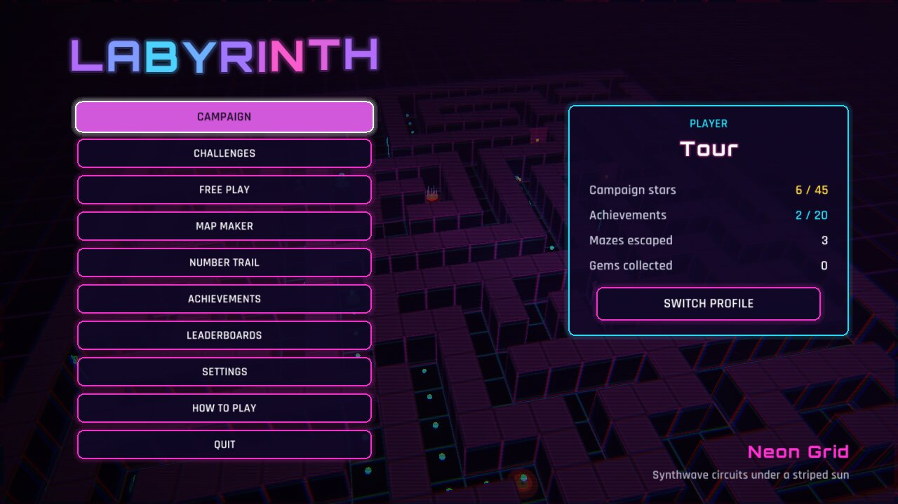
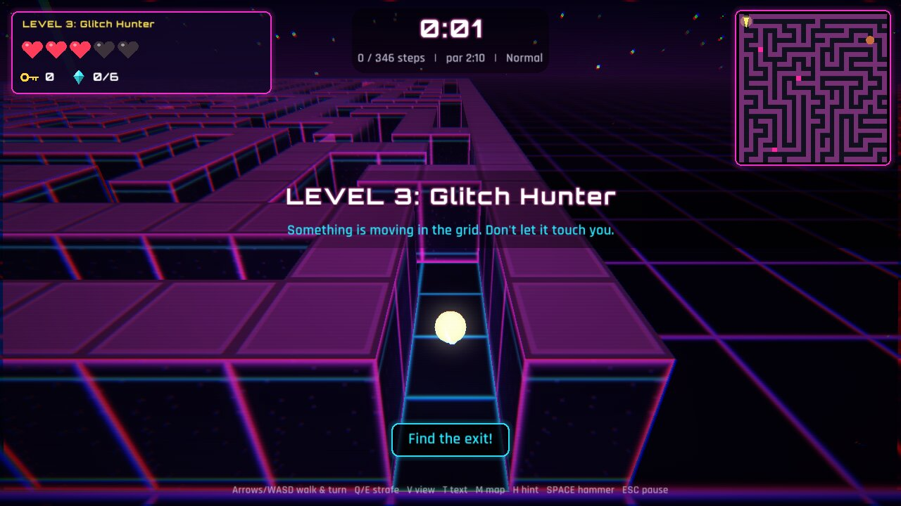
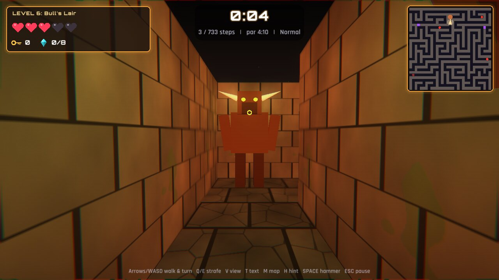
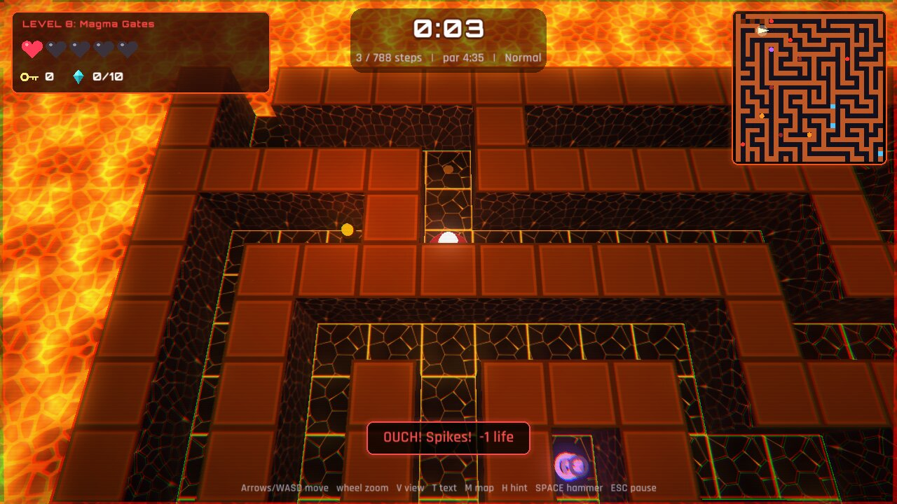
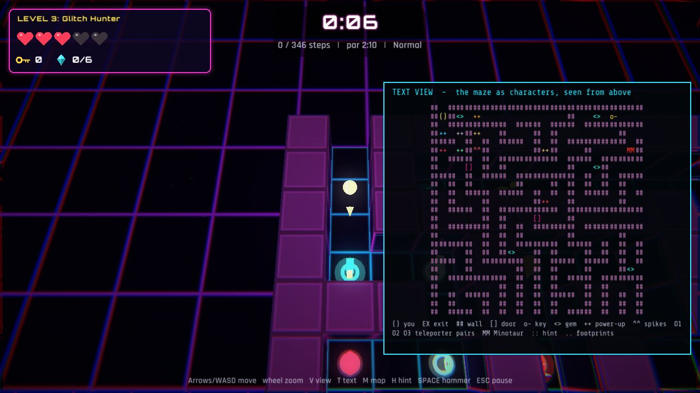
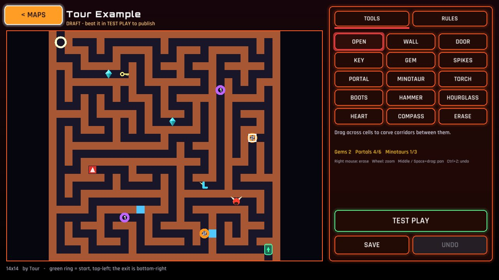
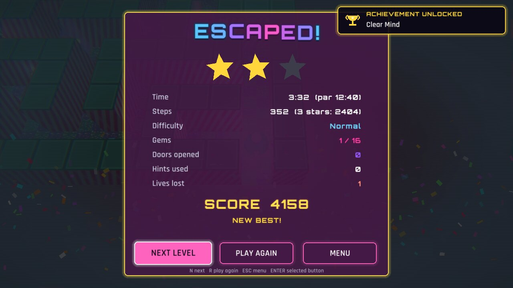

# LABYRINTH — a 3D maze adventure in C++

Escape glowing neon grids, torch-lit dungeons, lava caves, frozen crystal halls and a candy kingdom — in third person, first person or from above — while a Minotaur hunts you through the corridors.



| | |
|---|---|
|  |  |
|  |  |
|  |  |

## Features

**Playing**
- Three 3D views, switched with `V`: a **third-person chase camera** (the default), **first person** with head-bob, and **top-down**.
- **Text view** (press `T`): the maze drawn with characters, seen from above, side panel or full-screen retro terminal.
- Full **map** (`M`), live **minimap**, **hint** route (`H`).
- **4 difficulties** (Easy, Normal, Hard, Expert): harder means less time and fewer steps allowed for 3 stars, faster Minotaurs and more points.
- Mazes from **10x10 to 50x50**, generated at random every time (or from a seed).

**Things in the maze**
- **Keys and special doors**: doors are shortcuts towards the exit; each needs a key, and there are fewer keys than doors.
- **Gems**, and exits that stay sealed until every gem is found.
- Power-ups: **Torch, Speed Boots, Hammer** (smash one wall, rare, −40 points), **Hourglass** (freeze the Minotaur), **Heart** (never in one-life runs), **Compass** (draws a free route to the nearest gem, then the exit).
- **Spike traps** that rise and fall in a rhythm (red warning plates, extra visible from above), and **teleporter** pads in dead ends; each pair has its own colour and number.
- **The Minotaur**: wanders until it smells you, then hunts you with path-finding. Red eyes, a heartbeat that speeds up as it gets closer, and a roar when it finds you.
- **Fog of war** levels where you only see what your torch lights up.

**Modes**
- **Campaign**: 15 levels in 5 worlds, rated with 1 to 3 stars, ending in a 50x50 maze with three Minotaurs.
- **6 challenges**: Daily Maze (the same maze for everyone today), Time Attack, Blackout, **Minotaur Hunt** (a gauntlet: three Minotaurs are let loose behind you, one after another), Iron Runner, Gem Rush.
- **Free Play**: build your own maze by choosing size, seed, world, Minotaurs, lives, gems, traps, fog, time limit and hints.
- **Number Trail**: the "follow the smallest numbers" puzzle from the assignment, with combos, a timer and mouse support.
- **Map Maker** with a step-by-step **tutorial**: draw your own maze with 15 tools (carve, walls, doors, keys, gems, spikes, portals, Minotaur lairs, power-ups), set its rules, and share it as a `.lmap` file. A map can only be published after its maker **beats it in a test play**, so no shared map is impossible.

**Everything else**
- **Profiles** with statistics, **20 achievements**, **leaderboards** for every mode, and **Save & Continue** in the middle of a game.
- **5 themed worlds**, each with its own procedurally generated textures, sky, lighting, particles and **synthesized music**.
- Post-processing: **bloom glow**, retro **CRT scanlines**, chromatic aberration, damage flashes, danger pulses.
- **Settings**: volume, mute in background, fullscreen, bloom, CRT, field of view, starting view, difficulty, "reduce motion & flashes" (accessibility), FPS counter, admin code.
- Keyboard, mouse **and gamepad** everywhere. `F11` or `Alt+Enter` fullscreen on/off (always), `F12` screenshot, `F3` FPS counter on/off.
- **No asset files**: every texture, sound and song is generated in code, and the fonts are embedded. The game is a single `.exe`.

## Download and play

- **Windows:** run **`windows/Labyrinth.exe`**. Nothing needs to be installed. Profiles, settings, saved games and maps are saved automatically **on each computer, per Windows user** (`%LOCALAPPDATA%\Labyrinth`; on Linux `~/.local/share/labyrinth`, on macOS `~/Library/Application Support/Labyrinth`), so they survive closing the game, crashes, and even running it straight from the zip. Settings shows the exact folder. To keep everything next to the program instead (e.g. on a USB stick), put an empty file named `portable.txt` beside it.
- **Everything unlocked:** pick the ready-made **Admin** profile, or type the admin code **`MINOTAUR`** in *Settings*. Admin profiles can press `F9` in a game to warp to the exit (handy for testing).
- **Linux:** run `linux/Labyrinth` (built on Ubuntu 24.04; on other systems build from source).
- **macOS:** build from source (below) — about two minutes.

The `windows/` and `linux/` folders hold ready-made builds; they are not committed to git (attach them to a GitHub Release instead).

## Building from source

The project uses **CMake**, which downloads raylib 5.5 with **git** automatically the first time it builds (internet needed once).

### Windows — Visual Studio 2022
1. *File → Open → Folder…* and choose this folder.
2. Wait for "CMake generation finished" (the first time it downloads raylib).
3. Pick **Labyrinth.exe** as the startup item and press **F5**.

### Windows / Linux / macOS — command line
```bash
cmake -S . -B build
cmake --build build --config Release
./build/Labyrinth                 # the 3D game (build\Release\Labyrinth.exe on Windows)
./build/labyrinth_tests           # 74 automated tests
./build/labyrinth_console         # the classic terminal edition
```

| System | Needs |
|---|---|
| Windows | Visual Studio 2022 with the *Desktop development with C++* workload (includes CMake and git) |
| macOS | `xcode-select --install` (compiler + git) and `brew install cmake` |
| Linux | `sudo apt install build-essential cmake git libx11-dev libxrandr-dev libxinerama-dev libxcursor-dev libxi-dev libgl1-mesa-dev libasound2-dev` |

The tests and the terminal edition need no graphics libraries: `make test` / `make run` also work.

## Controls

| Key | Third / first person | Top-down / text view |
|---|---|---|
| ↑ / W | walk forward | move up |
| ↓ / S | step back | move down |
| ← / A, → / D | turn left / right | move left / right |
| Q / E | step sideways | — |
| V or Tab | third person → first person → top-down | |
| T | text view: off → side panel → full screen | |
| M | full map | |
| H | hint (shows the shortest route, −100 points) | |
| Space | smash the wall in front of you (needs a hammer) | |
| Esc / P | pause, save & quit | |
| Mouse wheel | — | zoom |
| F9 | warp to the exit (admin profiles only) | |

A tap is always exactly one step or one 90° turn, however firmly you press; hold the key to keep walking (or to keep turning, more slowly).

On the results screen: `Enter` the selected button, `←`/`→` choose, `N` next level, `R` play again, `Esc` menu.

**Map maker:** left mouse = use the tool (drag across cells to carve or wall), right mouse = erase, wheel = zoom, middle mouse or Space + drag = pan, `Ctrl+Z` = undo. Drop a `.lmap` file onto the window to add a friend's map.

Gamepad: D-pad/stick to move, A = hammer, X = hint, Y = view, Start = pause.

## How the code is organised

```
src/
  maze.*  game.*  campaign.*  profile.*      game rules - pure logic:
  savegame.*  number_trail.*  validation.*   no cin/cout, no graphics, fully tested
  custom_map.*                               hand-made maps: editing rules, checks, .lmap files
  app/                                       the 3D app (raylib)
    main.cpp          window, main loop, screen transitions, saving
    render3d.cpp      maze meshes, lighting shader, props, Minotaur, cameras
    postfx.cpp        bloom, CRT, vignette, flashes
    theme.cpp         5 worlds: palettes, generated textures, skies
    particles.cpp     sparkles, confetti, embers, snow...
    audio.cpp         synthesized sound effects and music
    widgets.cpp       fonts, buttons, sliders, text fields, icons
    screen_*.cpp      menus, campaign, challenges, game, Number Trail, map maker
  input.* ui.* main.cpp                      the classic terminal edition
tests/test_main.cpp                          74 automated tests (1078 checks)
tools/                                       font embedding, the icon (make_icon.py), MinGW toolchain
docs/                                        technical, QA, plan, presentation, code tour, GitHub plan
```

The game rules never draw anything or read the keyboard. The app only *reads* the game state, draws it, and turns key presses into calls such as `movePlayer()`. That is why the rules can be tested automatically, and why the 3D app and the terminal edition share the same rules.

## How the assignment requirements are met

| # | Requirement | Where |
|---|---|---|
| 1 | A maze the player must get through to win | `movePlayer()` / `isExitCell()` in `game.cpp`, the game screen in `app/screen_game.cpp` |
| 2 | Dynamic arrays, size chosen 10x10 – 50x50 | `Tile** tiles` (`maze.cpp`), `Item** items`, `bool**` grids, `Minotaur*` array (`game.cpp`); size slider in Free Play |
| 3 | Start at (0, 0), exit at the bottom-right | `startRun()`: `playerRow = playerCol = 0`; `isExitCell()` checks `(size-1, size-1)` |
| 4 | Maze redrawn with the player's position after every move | the 3D view, minimap and text view are redrawn every frame from the game state |
| 5 | Text maze, top-down view | **Text view** (`T`): `drawTextView()` in `app/screen_game.cpp`; also the terminal edition |
| 6 | Player sees walls, openings and the exit | walls, open corridors, glowing exit beacon, legend in the text view and in *How to play* |
| 7 | A new maze every time the program runs | Free Play and challenges use `generateRandomSeed()` |
| 8 | Arrow keys; no walking through walls except special doors | `handleMovementInput()` → `movePlayer()`: walls block, doors open with a key |
| 9 | Functions for maintaining and drawing the maze | `maze.cpp` (create, carve, doors, path-finding), `render3d.cpp` / `drawTextView()` / `drawMapArea()` |
| 10 | Logic functions without `cin` / `cout` | everything in `src/*.cpp` except `input.cpp` and `ui.cpp` |
| 11 | Menu | main menu, campaign, challenges, free play, map maker, settings, pause menu (`app/screen_*.cpp`) |
| 12 | Validation of user input | `validation.cpp`; profile names, seeds, sliders and steppers are range-checked; text fields accept only allowed characters; save files are checked line by line |
| Ex. | "Smallest numbers" example | Number Trail mode (`number_trail.cpp`, `app/screen_trail.cpp`) |

## Credits

| Role | Name | Responsible for |
|---|---|---|
| Scrum Trainer | _name_ | planning, GitHub board, presentation |
| Backend Developer | _name_ | game rules: `maze`, `game`, `campaign`, `savegame`, `custom_map`, `number_trail` |
| Frontend Developer | _name_ | the app: `src/app/` |
| QA | _name_ | `tests/`, `validation`, `profile`, QA documentation |

Third-party: [raylib](https://www.raylib.com) (zlib licence). Fonts: Orbitron, Rajdhani and Share Tech Mono (SIL Open Font License, see `assets/fonts/`).
